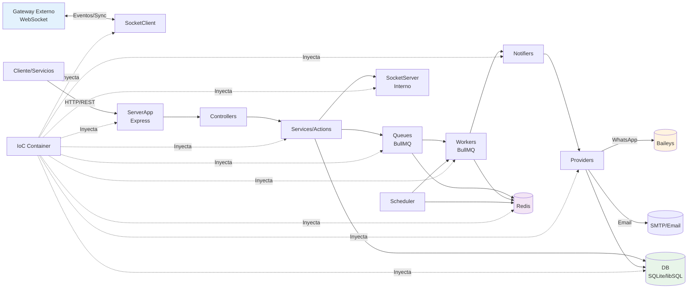

# Arquitectura

## Componentes principales

- **ServerApp (Express)**: Expone API REST, middleware, rutas de controladores y maneja errores. Actúa como punto de entrada HTTP.
- **SocketServer**: Servidor WebSocket interno para comunicación entre componentes.
- **SocketClient**: Cliente WebSocket que se conecta al gateway externo (processor) para recibir eventos y sincronizar datos.
- **Workers (BullMQ)**: Procesadores de colas independientes para cada canal: `EmailWorker`, `WhatsAppWorker`, `SmsWorker`. Cada uno consume trabajos y delega al notifier correspondiente.
- **Queues (BullMQ)**: Colas para cada canal (`EmailQueue`, `WhatsappQueue`, `SmsQueue`) que desacoplan la recepción de solicitudes del procesamiento.
- **Notifiers**: Encargados de enviar notificaciones por cada canal (`EmailNotifier`, `WhatsappNotifier`). Abstraen el proveedor específico.
- **Providers**: Implementación concreta de conexión/envío por canal (`EmailProvider`, `WhatsappProvider`). WhatsApp utiliza [Baileys](https://github.com/WhiskeySockets/Baileys).
- **Controllers/Services/Actions**: Capa de aplicación para gestionar canales, credenciales y lógica de negocio.
- **DatabaseProvider + Drizzle**: Acceso a base de datos (SQLite/libSQL) con esquemas definidos.
- **RedisApp**: Wrapper de Redis para conexión compartida entre workers/colas.
- **IoC Container (Awilix)**: Inyección de dependencias entre componentes. Centraliza la creación y singletones.
- **Scheduler**: Tareas programadas internas.

## Arquitectura - Diagrama

