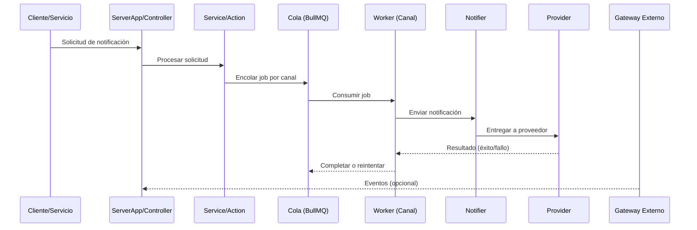

# Flujo básico

## Descripción

El flujo principal consiste en recibir una solicitud de notificación (vía API REST o eventos desde el gateway), encolarla por canal correspondiente y procesarla mediante workers para su envío.

## Pasos del flujo

1. **Recepción**: Un cliente/servicio solicita enviar una notificación a través del API REST (`ServerApp` → `Controller`).
2. **Validación/Lógica**: El controlador delega a servicios/actions que validan y determinan el canal (Email/WhatsApp/SMS).
3. **Encolado**: Se agrega un job a la cola correspondiente (`EmailQueue`/`WhatsappQueue`/`SmsQueue`) en Redis.
4. **Procesamiento**: El worker del canal consume el job (`EmailWorker`/`WhatsappWorker`/`SmsWorker`) aplicando límites de concurrencia y reintentos.
5. **Envío**: El worker delega al `Notifier`, quien utiliza el `Provider` para enviar la notificación al destino.
6. **Resultado**: El estado se registra en base de datos; en caso de fallo se reintenta según configuración de la cola.
7. **Sincronización externa**: El `SocketClient` mantiene conexión con el gateway externo para recibir eventos/actualizaciones que pueden desencadenar nuevas notificaciones.

## Flujo básico - Diagrama

